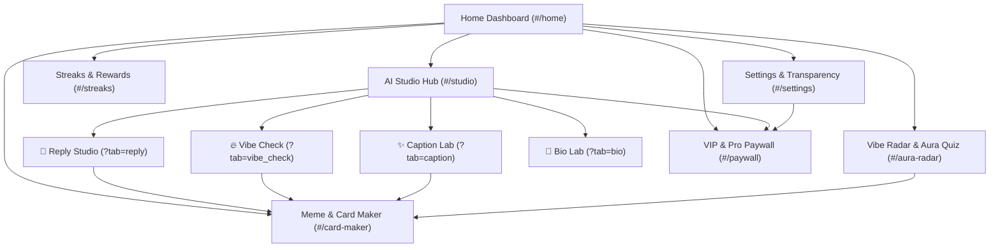

# VibeKit AI — Design System & Stitch Specification (`DESIGN.md`)

This document defines the complete visual identity, design tokens, component architecture, and multi-screen user flow for **VibeKit AI** to import directly into **Google Stitch** (Google Labs).

---

## 🎨 1. Brand Identity & Design Tokens

### Philosophy: Warm Oat Latte & Roasted Espresso Ambiance
* **Aesthetic:** Minimalist, editorial, tactile coffeehouse warmth. Avoids loud saturated neo-morphism or cold sterile corporate gray.
* **Mood:** High charisma, relaxed, effortless texting copilot.

### Color Palette

#### Light Theme (Warm Oat Cream & Biscuit Latte)
| Token | Hex Value | Usage |
| :--- | :--- | :--- |
| `background` | `#FAF7F2` | Primary canvas & scaffold background |
| `surfaceCard` | `#F4EFE6` | Content cards, text inputs, containers |
| `surfaceElevated`| `#ECE4D8` | Active chips, elevated modals |
| `primary` | `#6B4226` | Deep Roasted Mocha (Primary buttons, active indicators) |
| `primaryLight` | `#8C5A38` | Secondary action highlights |
| `accent` | `#C86D3C` | Warm Terracotta / Burnt Orange (Sparks, CTA badges) |
| `accentWarm` | `#E5A96A` | Golden Honey / Caramel (Accents, star ratings) |
| `textPrimary` | `#2D1E17` | High-contrast espresso typography |
| `textSecondary`| `#7D685C` | Subtitles, helper text, character counters |
| `border` | `#E8DED2` | Subtle hairline card borders |

#### Dark Theme (Roasted Espresso Bean)
| Token | Hex Value | Usage |
| :--- | :--- | :--- |
| `background` | `#140E0A` | Deep obsidian roasted coffee background |
| `surfaceCard` | `#1E1510` | Studio containers, card maker canvas |
| `surfaceElevated`| `#2B1D16` | Elevated cards, dialog backgrounds |
| `primary` | `#E28743` | Glowing warm ember (Primary buttons, active text) |
| `accent` | `#FF9E58` | Vivid spark highlights |
| `textPrimary` | `#FAF5EE` | Crisp white cream typography |
| `textSecondary`| `#A8988D` | Secondary muted text |
| `border` | `#33231B` | Card outline borders |

---

## ✍️ 2. Typography Hierarchy

* **Display & Brand Headings:** `Outfit` (Geometric, friendly, modern)
  * `H1 (Page Title):` 24px, Bold (700), -0.5px letter spacing
  * `H2 (Section Header):` 18px, Semi-Bold (600)
  * `H3 (Card Title):` 15px, Bold (700)
* **Body & UI Text:** `-apple-system`, `SF Pro Display`, `Roboto`
  * `Body Regular:` 14px, Height 1.45, Regular (400)
  * `Body Medium:` 14px, Medium (500)
  * `Caption / Micro:` 11px, Bold (700), uppercase tracking +1px

---

## 🧩 3. Component Library

### 1. `DailyVibeSparkHero`
* **Layout:** Full-width rounded card (Radius 20px) with subtle radial gradient.
* **Elements:**
  * Top badge: `⚡ DAILY VIBE SPARK` pill.
  * Quote / Scenario: 17px bold text (e.g., *“Replying to ‘k’ after 6 hours of silence”*).
  * 1-Tap CTA button: `🔥 Spark Savage Comeback`.
  * Secondary button: Shuffle scenario (`🔄`).

### 2. `StudioTile` (Grid Cards)
* **Layout:** 2-column rounded cards (Radius 18px).
* **Elements:**
  * Icon container with pastel tint background.
  * Live status pill top-right (`🔥 HOT`, `⚡ VIRAL`, `✨ TREND`, `💎 POPULAR`, `🎨 100% OFFLINE`).
  * Title (15px bold) + Subtitle (12px secondary).

### 3. `ResultCard`
* **Layout:** Elevated card displaying AI-generated text.
* **Actions Row:**
  * `Copy` (Clipboard)
  * `Share` (Native system share)
  * `Favorite` (Heart toggle)
  * `Flag/Report` (Google Play Generative AI compliance modal)
  * `Make Card` (Opens Card Maker with text preloaded)

### 4. `CardCanvas` (Meme & Quote Designer)
* **Layout:** 1:1 or 4:5 aspect ratio local hardware canvas.
* **Elements:**
  * Quotes glyph `“`
  * Center statement typography
  * Author handle / signature
  * Branding watermark (`✨ Made with VibeKit AI`)

---

## 🗺️ 4. Multi-Screen Navigation Graph

---

## 📁 5. Screen Reference Assets Directory

High-fidelity reference captures to upload directly into Google Stitch canvas:

1. **Home Screen:** `store_assets/screenshot_01_home.png`
2. **Reply Studio:** `store_assets/screenshot_02_reply_studio.png`
3. **Vibe Check & Roaster:** `store_assets/screenshot_03_vibe_check.png`
4. **Caption & Reel Hook Lab:** `store_assets/screenshot_04_caption_lab.png`
5. **Meme & Quote Card Maker:** `store_assets/screenshot_05_card_maker.png`
6. **Vibe Streaks & Gamification:** `store_assets/screenshot_06_streaks_rewards.png`
7. **VIP Paywall Screen:** `store_assets/screenshot_07_pro_paywall.png`

