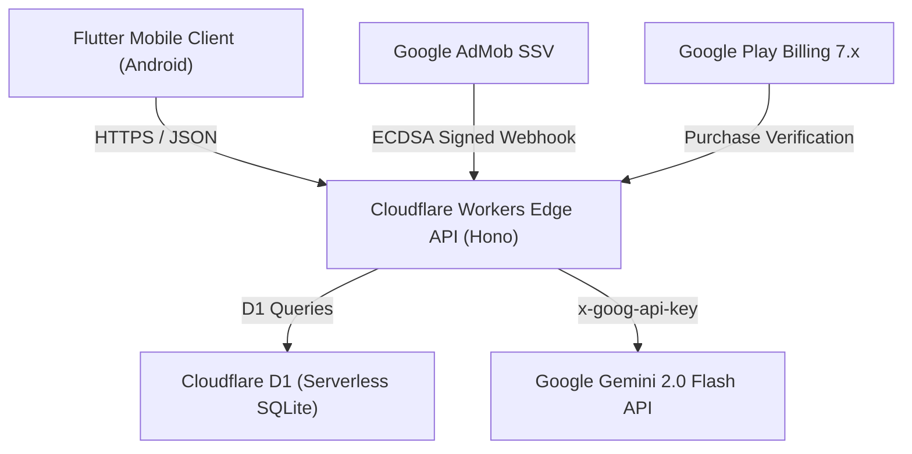

# VibeKit AI — Complete Application Specification & System Details

> **Document Purpose:** This document is an exhaustive, self-contained overview of the **VibeKit AI** project. You can copy and paste this entire markdown document into ChatGPT, Claude, or any LLM to analyze, generate marketing copy, write new features, or assist in management.

---

## 1. App Identity & Executive Overview

* **App Name:** VibeKit AI
* **App Subtitle / Tagline:** AI Chat Replies, Captions, Bios & Vibe Roaster
* **Package Name (Android):** `com.vibekit.vibekit_ai`
* **Version:** `1.0.1` (Version Code: `2`)
* **Category:** Social / Productivity / Tools
* **Target Audience:** Gen-Z, Millennials, Social Media Creators, Dating App Users (Tinder, Bumble, Hinge), Influencers, and Professionals.
* **Platforms:**
  * **Frontend Client:** Android (Flutter 3.x, Target SDK 36, Min SDK 24).
  * **Backend Edge API:** Cloudflare Workers (TypeScript, Hono framework).
  * **Edge Database:** Cloudflare D1 (Serverless Distributed SQLite).
  * **Primary AI Engine:** Google Gemini 2.0 Flash via Generative Language API.

---

## 2. Core Value Proposition & Key Features

VibeKit AI is an all-in-one social communication and content creation copilot designed to eliminate conversational anxiety, craft viral social content, and analyze messaging dynamics.

### A. Smart AI Chat Reply Generator
* **Purpose:** Helps users reply to incoming messages across dating apps, WhatsApp, Instagram DMs, iMessage, and LinkedIn.
* **Input Options:** Direct text pasting or screenshot image input (OCR).
* **Tones Available:**
  * *Witty / Savage* (Clever banter, playful comebacks)
  * *Flirty / Romantic* (Smooth dating app openers, high-charm replies)
  * *Chill / Casual* (Low-pressure, effortless aesthetic)
  * *Ghost / Soft Rejection* (Polite brush-offs and boundary setting)
  * *Professional / Boss Mode* (Assertive corporate communication, boundary negotiation)
* **Output:** Delivers multiple ranked reply suggestions (Short, Balanced, Detailed) with 1-tap copy, card export, and bookmarking.

### B. Caption Lab & Bio Studio
* **Platforms Supported:** Instagram (Reels & Feed), TikTok, YouTube Shorts, X (Twitter), Threads, LinkedIn, Dating Profiles.
* **Tones Supported:** *Trendy, Aesthetic, Witty, Confident, Professional, Inspirational, Humorous, Savage, Chill, Poetic, Hustle, Minimalist*.
* **Smart Enhancements:**
  * Viral Hook generation (proven curiosity gap formulas).
  * Smart hashtag suggestions (#aesthetic, #fyp, trending tags).
  * Call-To-Action (CTA) suggestions (e.g., "Save this for later", "Drop your thoughts below").
  * Unique username and handle recommendations for bios.

### C. Vibe Check & Message Roaster
* **Purpose:** Rates incoming or drafted messages before sending.
* **Vibe Score (1–100):** Evaluates energy, confidence, desperation level, and tone.
* **Tone Tags:** Generates instant badges (e.g., `Overthinking`, `Dry Texter`, `Main Character`, `W Rizz`).
* **AI Roast:** Playful, brutally honest Gen-Z critique of why the message fails or succeeds.
* **Leveled-Up Rewrites:** Provides 3 upgraded versions:
  * *Vibe Polish:* Warmer, more magnetic phrasing.
  * *Boss Mode:* Assertive, high-status, zero-apology phrasing.
  * *Smooth Operator:* Casual, effortless charm.

### D. Aesthetic Card Maker & Social Exporter
* **Purpose:** Transforms generated quotes, roasts, comebacks, and captions into visually stunning, shareable aesthetic graphic cards.
* **Customization:**
  * Vibrant gradient themes (Midnight Neon, Sunset Glow, Cyberpunk, Obsidian, Cotton Candy).
  * Clean typography (Modern Sans, Elegant Serif, Retro Monospace).
  * Custom aspect ratios for Instagram Stories (9:16) and Square Posts (1:1).
* **High-Performance Export:** Single-pass bitmap rasterization engine directly saving PNG images to device gallery or triggering native OS share sheet.

### E. Gamification & Retention Engine
* **Daily Streaks:** Tracks consecutive days of use with flame icons and countdowns.
* **XP & Level Progression:**
  * 10–50 XP awarded for generation actions, daily check-ins, sharing cards, and referrals.
  * Levels scale dynamically: `Level = floor(Total XP / 100) + 1`.
* **Streak Freezes:** Users earn streak freeze passes to protect streaks when offline.
* **Daily Aura Radar:** Interactive radar predicting user's daily social vibe and energy score.

---

## 3. Technology Stack & System Architecture



### Frontend (Mobile App)
* **Framework:** Flutter 3.x (Dart 3.x).
* **State Management:** Riverpod (`StateNotifierProvider`, `ChangeNotifierProvider`).
* **Local Storage:** `sqflite` / local SQLite database for offline creations, favorites, history, and cached stats.
* **Monetization SDKs:**
  * `google_mobile_ads` (Adaptive Banners, Capped Interstitials, Rewarded Video Ads).
  * `in_app_purchase` (Google Play Billing with client-side reactive state tracking).
* **Rendering & Design:** Custom dark-mode aesthetic, Glassmorphism, smooth animations, and zero heavy asset bloat.

### Backend (Edge Serverless API)
* **Runtime:** Cloudflare Workers (V8 isolates with sub-50ms cold starts worldwide).
* **Framework:** Hono (ultra-lightweight web framework for edge runtimes).
* **Language:** TypeScript 5.7+ (Strict Mode).
* **Database:** Cloudflare D1 (Global distributed SQLite with transactions, prepared statements, and batching).
* **Validation:** Zod schemas enforcing strict input sanitization on all endpoints.
* **Security & Defense:**
  * Zero permanent storage of user conversation logs or AI generation prompts (Privacy-First).
  * Rate limiting middleware with circuit-breaker protection.
  * Server-Side Verification (SSV) for AdMob rewarded video ads with ECDSA public key signature validation.
  * Idempotency key tracking to avoid accidental double-charging of credits.

---

## 4. Monetization Strategy & Product Catalog

VibeKit AI utilizes a high-converting **Freemium + Ad-Supported + In-App Subscription** hybrid model.

### In-App Products & Subscriptions (Configured in Google Play Console)

| Type | Product ID | Pricing (USD Default) | Entitlements |
|---|---|:---:|---|
| **Subscription** | `vibekit_pro_yearly` | $29.99 / year | Unlimited AI generations, All Tones, Pro Card Themes, Zero Ads, 3-Day Free Trial. |
| **Subscription** | `vibekit_pro_monthly` | $4.99 / month | Unlimited AI generations, All Tones, Zero Ads. |
| **Subscription** | `vibekit_pro_weekly` | $1.99 / week | Flexible entry subscription tier. |
| **In-App Purchase** | `vibekit_pro_lifetime` | $49.99 one-time | Lifetime VIP access, all future updates, zero recurring fees. |
| **In-App Purchase** | `vibekit_credits_50` | $1.99 consumable | 50 AI Credits top-up pack. |

### Free Tier & Ad Monetization Mechanics
* **Daily Free Credits:** Every installation receives 5 free credits daily.
* **Rewarded Video Ads:** Users can watch opt-in video ads to earn +3 credits per view (verified by Cloudflare edge worker via AdMob SSV).
* **Adaptive Banner Ads:** Positioned cleanly at the bottom of non-intrusive screens; automatically suppressed for Pro users.
* **Interstitial Ads:** Natural transition triggers (e.g. after card export), strictly capped at a maximum of 3 per day with a 180-second cooldown timer. Pro users never see interstitials.

---

## 5. Cloudflare D1 Database Schema

```sql
-- Installations (Identifies unique app installs anonymously)
CREATE TABLE IF NOT EXISTS installations (
  id TEXT PRIMARY KEY,
  created_at TEXT NOT NULL,
  last_active_at TEXT NOT NULL,
  pro_status TEXT DEFAULT 'free',
  pro_expires_at TEXT,
  pro_product_id TEXT,
  referral_code TEXT UNIQUE,
  referred_by TEXT
);

-- Daily Usage & Credit Quota
CREATE TABLE IF NOT EXISTS daily_usage (
  id TEXT PRIMARY KEY,
  installation_id TEXT NOT NULL,
  usage_date TEXT NOT NULL,
  free_credits_used INTEGER DEFAULT 0,
  rewarded_credits_earned INTEGER DEFAULT 0,
  rewarded_ads_watched INTEGER DEFAULT 0,
  updated_at TEXT NOT NULL,
  FOREIGN KEY (installation_id) REFERENCES installations(id)
);

-- AdMob SSV Transactions (Prevents ad replay attacks)
CREATE TABLE IF NOT EXISTS admob_ssv_transactions (
  transaction_id TEXT PRIMARY KEY,
  installation_id TEXT NOT NULL,
  reward_id TEXT,
  key_id TEXT,
  verified_at TEXT NOT NULL,
  ad_network TEXT DEFAULT 'admob',
  FOREIGN KEY (installation_id) REFERENCES installations(id)
);

-- Streaks & Gamification
CREATE TABLE IF NOT EXISTS streaks (
  installation_id TEXT PRIMARY KEY,
  current_streak INTEGER DEFAULT 0,
  longest_streak INTEGER DEFAULT 0,
  total_xp INTEGER DEFAULT 0,
  last_checkin_date TEXT,
  freeze_credits INTEGER DEFAULT 0,
  updated_at TEXT NOT NULL,
  FOREIGN KEY (installation_id) REFERENCES installations(id)
);

-- XP Log
CREATE TABLE IF NOT EXISTS xp_events (
  id TEXT PRIMARY KEY,
  installation_id TEXT NOT NULL,
  action TEXT NOT NULL,
  xp_awarded INTEGER NOT NULL,
  created_at TEXT NOT NULL,
  FOREIGN KEY (installation_id) REFERENCES installations(id)
);

-- Generation Idempotency Cache
CREATE TABLE IF NOT EXISTS generation_cache (
  idempotency_key TEXT PRIMARY KEY,
  installation_id TEXT NOT NULL,
  endpoint TEXT NOT NULL,
  response_json TEXT NOT NULL,
  created_at TEXT NOT NULL
);
```

---

## 6. Edge Backend API Reference

Base Production URL: `https://api.vibekit.ai` (or configured Cloudflare Workers worker URL).  
Common Header: `X-Installation-Id: <uuid>` (Identifies the client).

### Endpoints:

1. **`POST /v1/replies/generate`**
   * **Body:** `{"message": "string", "tone": "Witty|Flirty|Chill|Ghost|Professional", "language": "English|Hindi|Hinglish|Gujarati", "count": 3}`
   * **Returns:** `{"success": true, "suggestions": ["..."], "credits_remaining": 4}`

2. **`POST /v1/captions/generate`**
   * **Body:** `{"topic": "string", "platform": "Instagram Reels|TikTok|Threads & X", "tone": "Trendy|Aesthetic|Savage|...", "include_hooks": true, "include_hashtags": true}`
   * **Returns:** `{"success": true, "captions": ["..."], "hooks": ["..."], "hashtags": ["#..."]}`

3. **`POST /v1/bios/generate`**
   * **Body:** `{"interests": "string", "platform": "Instagram|LinkedIn|Dating App", "vibe": "Aesthetic|Witty|Minimalist|Bold", "include_usernames": true}`
   * **Returns:** `{"success": true, "bios": ["..."], "usernames": ["@..."]}`

4. **`POST /v1/vibe-check`**
   * **Body:** `{"text": "string", "mode": "roast|vibe_polish|boss_mode"}`
   * **Returns:** `{"success": true, "score": 88, "title": "Main Character Energy", "verdict": "string", "tags": ["..."], "rewrites": ["..."]}`

5. **`POST /v1/streaks/checkin`**
   * **Body:** `{"action": "daily_checkin|card_share|referral"}`
   * **Returns:** `{"success": true, "current_streak": 5, "total_xp": 150, "xp_awarded": 15}`

6. **`POST /v1/ads/request-nonce`**
   * **Returns:** Cryptographic nonce for AdMob SSV tracking.

7. **`GET /v1/ads/admob-ssv`**
   * Validates Google AdMob Server-Side Verification ECDSA signatures and atomically increments user credits.

8. **`POST /v1/purchases/verify`**
   * Validates Google Play In-App Purchase tokens and grants Pro status or credit bundles.

9. **`POST /v1/privacy/delete-data`**
   * Complies with Google Play Data Deletion requirements; atomically deletes all user records from Cloudflare D1.

10. **`GET /v1/health`**
    * High-speed health check for uptime monitoring (exempt from rate limits).

---

## 7. Google Play Store Listing & ASO Strategy

### Metadata
* **App Title:** `VibeKit AI: Chat Replies, Bios` (30 characters)
* **Short Description:** `AI chat replies, aesthetic captions, dating openers, bios & vibe roaster.` (76 characters)
* **Target Rating:** PEGI 3 / Everyone.

### Primary ASO Keywords
`AI chat replies`, `rizz app`, `caption generator`, `dating app openers`, `instagram bio ideas`, `vibe check`, `comebacks`, `social media copilot`, `reels captions`, `witty replies`, `hinge openers`.

### Data Safety Declarations (Google Play Console)
* **Data Collected:** None linked to identity. Anonymous installation identifier (`UUID`) for quota enforcement and streak tracking only.
* **Data Shared:** Zero data shared with third parties.
* **Data Security:** All communications transmitted over encrypted HTTPS/TLS.
* **Data Deletion:** 1-tap in-app data purge and public URL `/delete-data` supported.

---

## 8. Development & Build Commands

### Backend Edge Worker
```bash
# Navigate to backend
cd backend

# Install dependencies
npm install

# Run TypeScript type check
npm run typecheck

# Run unit and regression test suite
npm test

# Run local development server
npm run dev

# Deploy live to Cloudflare Workers
npm run deploy
```

### Mobile App (Flutter)
```bash
# Navigate to app directory
cd app

# Fetch Flutter dependencies
flutter pub get

# Run Android debug on connected device/emulator
flutter run

# Build signed production Android App Bundle (AAB) for Play Store
flutter build appbundle --release \
  --dart-define=API_URL=https://api.vibekit.ai \
  --dart-define=ADMOB_APP_ID=ca-app-pub-3940256099942544~3347511713
```

---
*Generated by Antigravity Assistant — VibeKit AI Project Repository.*
