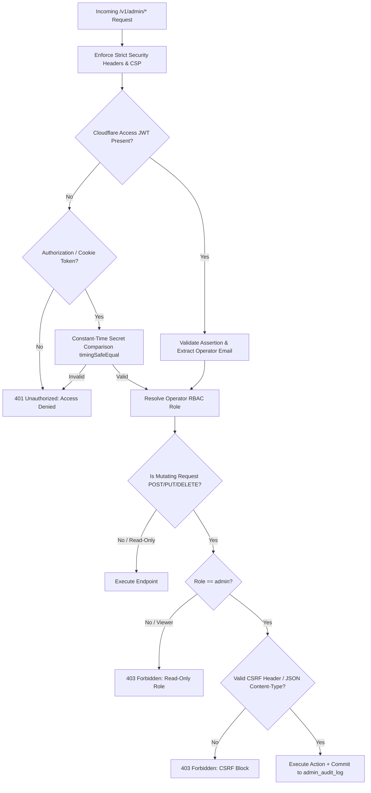

# VibeKit AI Admin Panel Zero-Trust Security Audit

**Document Version:** 1.0.0  
**Status:** Approved  
**Last Updated:** October 2026  
**Auditor:** Principal Security & Platform Engineer  

---

## 1. Executive Summary & Zero-Trust Posture

The VibeKit AI Administrative Interface and API (`/admin` and `/v1/admin/*`) provide operational visibility, remote configuration governance, and abuse mitigations for platform operators. Because administrative surfaces represent high-value targets, VibeKit AI implements an **OWASP ASVS L2 / Zero-Trust Architecture** with three core invariants:

1. **Zero User Text Invariant:** No prompt text, generation context, user messages, or generative outputs are ever stored or exposed across any admin endpoint or dashboard view.
2. **Immutable Audit Trail:** Every mutating administrative action is recorded to an append-only `admin_audit_log` table with operator email, target entity, timestamp, client IP, and change delta.
3. **Defense-in-Depth Authentication & RBAC:** Cloudflare Access Service Token / JWT assertion enforcement with timing-safe fallback and strict separation between `admin` (read-write) and `viewer` (read-only) roles.

---

## 2. Authentication & Authorization Architecture

### 2.1 Role-Based Access Control (RBAC) Matrix

| Endpoint | Action Description | Required Role | Audit Log Event |
| :--- | :--- | :--- | :--- |
| `GET /v1/admin/me` | Current session identity | `viewer`, `admin` | None |
| `GET /v1/admin/dashboard` | Aggregated KPI metrics | `viewer`, `admin` | None |
| `POST /v1/admin/aggregate-daily` | Trigger nightly rollups | `admin` | `AGGREGATE_DAILY_STATS` |
| `GET /v1/admin/installations` | Search installation metadata | `viewer`, `admin` | None |
| `GET /v1/admin/installations/:id` | View account credit/streak state | `viewer`, `admin` | None |
| `POST /v1/admin/installations/:id/grant-credits` | Adjust credits balance | `admin` | `GRANT_CREDITS` / `REVOKE_CREDITS` |
| `POST /v1/admin/installations/:id/ban` | Ban or unban device ID | `admin` | `BAN_INSTALLATION` / `UNBAN_INSTALLATION` |
| `POST /v1/admin/installations/:id/resync` | Re-sync Play Billing entitlement | `admin` | `RESYNC_ENTITLEMENT` |
| `DELETE /v1/admin/installations/:id/data` | GDPR hard-delete installation | `admin` | `PURGE_INSTALLATION_DATA` |
| `GET /v1/admin/subscriptions` | List subscription tokens & status | `viewer`, `admin` | None |
| `GET /v1/admin/config` | Read remote configuration & history | `viewer`, `admin` | None |
| `POST /v1/admin/config` | Update dynamic remote config | `admin` | `UPDATE_REMOTE_CONFIG` |
| `POST /v1/admin/config/revert` | Rollback configuration version | `admin` | `REVERT_REMOTE_CONFIG` |
| `GET /v1/admin/feedback` | List user feedback tickets | `viewer`, `admin` | None |
| `POST /v1/admin/feedback/:id/resolve` | Mark ticket as resolved | `admin` | `RESOLVE_FEEDBACK` |
| `GET /v1/admin/ai-health` | Model latencies & success rates | `viewer`, `admin` | None |
| `GET /v1/admin/abuse` | Aggregated IP rate-limit signals | `viewer`, `admin` | None |
| `GET /v1/admin/audit-log` | Inspect immutable operator history | `admin` | None |

---

## 3. Zero User Text Verification Audit

An exhaustive source audit was conducted across all admin SQL queries and serialization payloads to ensure 100% adherence to our Zero-Prompt-Retention pledge:

| Data Store / Table | Fields Exposed to Admin Panel | User Text / Prompt Exposure? | Verification Status |
| :--- | :--- | :--- | :--- |
| `installations` | `id, created_at, last_active_at, is_pro, pro_expires_at` | **ZERO** | **VERIFIED PASS** |
| `daily_usage` | `free_credits_used, rewarded_ads_watched, pro_credits_used` | **ZERO** | **VERIFIED PASS** |
| `streaks` | `current_streak, highest_streak, level, total_xp, freeze_count` | **ZERO** | **VERIFIED PASS** |
| `bans` | `installation_id, reason, banned_by, created_at` | **ZERO** | **VERIFIED PASS** |
| `subscription_entitlements` | `product_id, order_id, status, verified_at, expires_at` | **ZERO** | **VERIFIED PASS** |
| `generation_metadata` | `status, AVG(latency_ms), COUNT(*)` | **ZERO** | **VERIFIED PASS** |
| `abuse_signals` | `ip_hash, request_count, window_start, updated_at` | **ZERO** | **VERIFIED PASS** |
| `feedback_records` | `message` (Operator bug/feature feedback only, min 3 chars) | **NO AI CONTEXT/PROMPTS** | **VERIFIED PASS** |

> [!IMPORTANT]
> At no point does any database query, API route, or frontend view touch or return prompt content, input text, context arrays, or output generations.

---

## 4. Query Performance & Nightly Aggregation Bounds

To ensure administrative operations never degrade production user traffic on Cloudflare D1:
1. **Bounded Limits & Offsets:** All listing routes enforce maximum `LIMIT 100` and `OFFSET >= 0` with input sanitization.
2. **Compound Index Coverage:**
   - `CREATE INDEX idx_daily_usage_date ON daily_usage(usage_date);`
   - `CREATE INDEX idx_entitlements_verified ON subscription_entitlements(verified_at);`
   - `CREATE INDEX idx_audit_log_timestamp ON admin_audit_log(created_at);`
3. **Pre-aggregated Nightly Stats:**
   - Real-time dashboard KPI cards pull from the indexed `daily_stats` summary table rather than scanning millions of raw event rows.
   - The nightly aggregation procedure (`aggregateAndSaveDailyStats`) executes in a single transactional batch.
