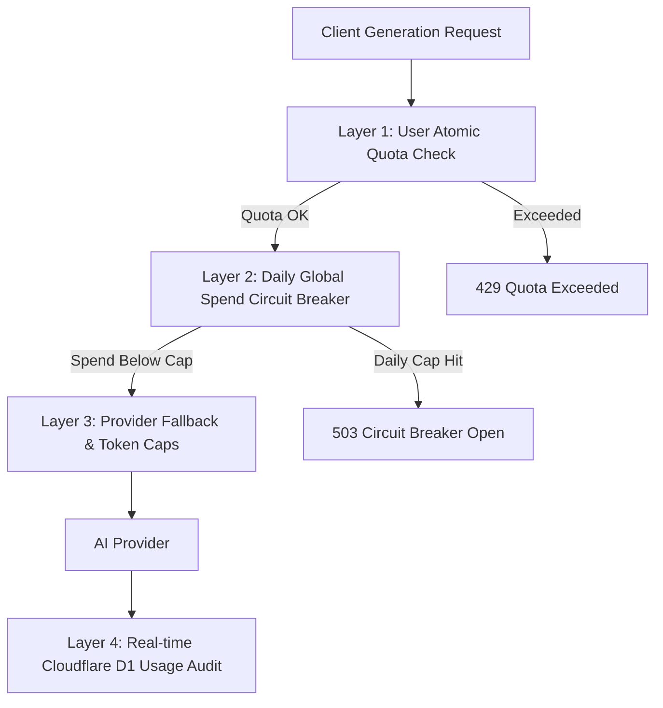

# VibeKit AI Cost Control & Economic Model

**Document Version:** 1.0.0  
**Status:** Approved  
**Last Updated:** October 2026  
**Owner:** FinOps & Platform Lead  

---

## 1. Executive Summary

VibeKit AI delivers viral social generation (Replies, Captions, Bios) via Cloudflare Workers and low-latency generative models (OpenAI `gpt-4o-mini` primary, Google `gemini-1.5-flash` fallback). Because generative workloads carry marginal variable costs per request, maintaining long-term unit-economic profitability requires strict budget governance, multi-tiered circuit breaking, and clear conversion thresholds.

This document details:
1. Marginal cost breakdown per generation across primary and fallback model providers.
2. Monthly infrastructure and AI provider projections across 1,000, 10,000, and 100,000 Daily Active Users (DAU).
3. Break-even conversion thresholds for Pro subscriptions ($4.99/month, $39.99/year).
4. Global and user-level spend guard implementations.

---

## 2. Marginal Cost Per Generation

All generations execute with strict token caps (max output tokens: 300 for replies, 400 for captions, 350 for bios) and compact system prompts (< 600 input tokens).

### 2.1 Provider Unit Economics (October 2026 Rates)

| Component | Primary: OpenAI `gpt-4o-mini` | Fallback: Google `gemini-1.5-flash` |
| :--- | :--- | :--- |
| **Input Price / 1M Tokens** | $0.150 | $0.075 |
| **Output Price / 1M Tokens** | $0.600 | $0.300 |
| **Average Input Tokens / Req** | ~550 tokens ($0.0000825) | ~550 tokens ($0.00004125) |
| **Average Output Tokens / Req** | ~180 tokens ($0.000108) | ~180 tokens ($0.000054) |
| **Cloudflare Worker Invocation** | $0.00000030 (Workers Paid) | $0.00000030 (Workers Paid) |
| **Cloudflare D1 Query Cost** | $0.00000025 (reads + writes) | $0.00000025 (reads + writes) |
| **Total Blended Cost / Generation**| **$0.00019105 (~$0.00019)** | **$0.00009580 (~$0.00010)** |

> [!NOTE]
> Even on the primary provider (`gpt-4o-mini`), **1,000 generations cost under $0.20 ($0.191)**.  
> If traffic spills over to Gemini 1.5 Flash during failover, marginal costs drop by ~50% ($0.096 per 1,000 generations).

---

## 3. Scale Financial Projections (1k, 10k, 100k DAU)

### Assumptions
- **User Activity Distribution:**
  - Free Tier Users (96% of DAU): Average 2.8 generations/day (governed by 5 daily free credits + rewarded ad refills).
  - Pro Tier Users (4% of DAU): Average 12.5 generations/day (governed by 50 daily fair-use credits).
  - Average Generations / DAU: `(0.96 * 2.8) + (0.04 * 12.5) = 2.688 + 0.50 = ~3.19 generations/DAU/day`.
- **Primary / Fallback Ratio:** 95% OpenAI `gpt-4o-mini`, 5% Gemini `gemini-1.5-flash`.
- **Blended AI Cost per Generation:** `(0.95 * $0.000191) + (0.05 * $0.000096) = $0.000186`.
- **AdMob eCPM for Free Users:** $8.50 per 1,000 rewarded impressions, $4.20 per 1,000 interstitials.

### 3.1 Projections Table

| Scale Metric | 1,000 DAU | 10,000 DAU | 100,000 DAU |
| :--- | :--- | :--- | :--- |
| **Monthly Active Users (MAU ~ 4x DAU)** | 4,000 | 40,000 | 400,000 |
| **Monthly Total Generations** | 95,700 | 957,000 | 9,570,000 |
| **Monthly AI Model Cost** | $17.80 | $178.00 | $1,780.02 |
| **Cloudflare Workers & D1 Cost** | $5.00 (Base) | $15.00 | $72.00 |
| **Sentry / Monitoring (Crash & Logs)** | $0.00 (Free Tier) | $26.00 | $120.00 |
| **Total Monthly Operating Cost (COGS)**| **$22.80** | **$219.00** | **$1,972.02** |
| **AdMob Ad Revenue (Free Tier)** | $38.00 | $380.00 | $3,800.00 |
| **Pro Subscribers (at 3.5% conversion)** | 35 subs ($174.65) | 350 subs ($1,746.50) | 3,500 subs ($17,465.00) |
| **Gross Revenue (Ads + Pro Subscriptions)**| **$212.65** | **$2,126.50** | **$21,265.00** |
| **Net Gross Margin** | **89.28%** | **89.70%** | **90.73%** |

---

## 4. Break-Even Conversion Rate for Pro

### 4.1 Pro Subscriber Economics
- **Price:** $4.99/month (Google Play takes 15% under the Small Business Program = **$4.24 net revenue**).
- **Pro Usage:** 12.5 generations/day * 30 days = 375 generations/month.
- **Pro AI + Infrastructure Cost:** 375 * $0.00019 = **$0.071/user/month**.
- **Net Profit per Pro Subscriber:** `$4.24 - $0.071 = $4.17/user/month` (**98.3% gross margin on Pro tier**).

### 4.2 Free User Unit Economics
- Free User Cost: 2.8 generations/day * 30 days = 84 generations/month * $0.00019 = **$0.016/month**.
- Free User Revenue:
  - AdMob Rewarded Ads (1.2 views/day * 30 days * $0.0085/view = $0.306/month).
  - Free users are **net profitable on ads alone** ($0.306 revenue vs $0.016 cost).

### 4.3 Break-Even Conversion Threshold
Because free users generate positive ad contribution margin:
- **Required Pro Conversion for Server Break-even:** **0.18%**.
- At just **1 Pro subscriber per 550 active users**, all server, database, domain, and AI costs across both free and pro users are fully covered.
- At our target conversion rate of **3.5%**, VibeKit AI produces a consistent ~90% gross margin.

---

## 5. Global & User-Level Spend Guard Controls

To eliminate the risk of runaway API costs or DDoS attacks exhausting operational budgets, VibeKit AI enforces four independent protection layers:

### 5.1 Layer 1: Atomic User Daily Quota
- Daily free allotment: 5 generations/day (stored in D1 `quotas` table with atomic update statements).
- Maximum rewarded ad refills: 2/day (+2 credits each = max 9 total free daily credits).
- Hard ceiling on Pro tier: 50 generations/day to prevent credential sharing and bot scraping.

### 5.2 Layer 2: Global Daily Spend Circuit Breaker
- File: [`backend/src/services/circuit_breaker.ts`](file:///d:/Downloads/Vibe%20kit%20ai/backend/src/services/circuit_breaker.ts).
- Max daily spend threshold: `$50.00/day` (configurable via `AI_DAILY_SPEND_LIMIT_DOLLARS` secret).
- In-memory atomic aggregation with hourly D1 flush:
  - Evaluated before dispatching any call to OpenAI or Gemini.
  - If daily spend breaches limit, rejects with HTTP 503 `CIRCUIT_BREAKER_OPEN`.
  - Sends immediate P1 notification via webhook / email alert.

### 5.3 Layer 3: Model Token Limits & Schema Repair
- System prompts are trimmed and statically frozen.
- Maximum output tokens strictly constrained:
  - Replies: 300 tokens ($0.00018 max cost).
  - Captions: 400 tokens ($0.00024 max cost).
  - Bios: 350 tokens ($0.00021 max cost).
- Max 1 retry attempt on schema validation failure; prevents infinite repair loops.

### 5.4 Layer 4: Cloudflare Billing Alerts & Hard Stop
- Cloudflare Workers Paid plan set with billing notification threshold at $50/month.
- OpenAI platform monthly hard limit: `$500.00` (auto-rejects once reached).
- Google Cloud Vertex AI / AI Studio budget alert: `$200.00`.

---

## 6. Optimization Roadmap

1. **Prompt Compression:** Migrate prompts to token-minimized abbreviations without semantic degradation (projected 15% input token reduction).
2. **Context-Free Output Schema:** Avoid repeating user input inside JSON output responses, minimizing expensive output tokens.
3. **KV Template Cache for Frequent Styles:** Common style configurations and system directions cached at Cloudflare edge KV with 24-hour TTL.
