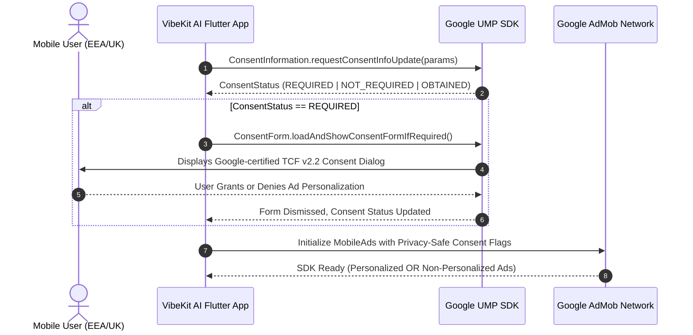

# Google UMP (User Messaging Platform) Consent Flow & Compliance

**Document Version:** 1.0.0  
**Status:** Approved  
**Last Updated:** October 2026  
**Applicability:** Android Client (`app/`) & Google Play Console  

---

## 1. Regulatory Context & Objectives

To monetize mobile applications in the European Economic Area (EEA), the United Kingdom, and Switzerland, Google Play and Google AdMob mandate compliance with the IAB Europe Transparency and Consent Framework (TCF v2.2) via a certified Consent Management Platform (CMP).

VibeKit AI implements the official Google User Messaging Platform (UMP) SDK bundled within `google_mobile_ads`.

---

## 2. Consent State Lifecycle



---

## 3. Implementation Specification

### 3.1 Initialization Sequence (Prior to Requesting Ads)

1. **Request Consent Info Update:**
   ```dart
   final params = ConsentRequestParameters(
     tagForUnderAgeOfConsent: false, // VibeKit AI is rated 13+
   );
   ConsentInformation.instance.requestConsentInfoUpdate(
     params,
     () async {
       if (await ConsentInformation.instance.isConsentFormAvailable()) {
         _loadAndShowForm();
       }
     },
     (FormError error) {
       debugPrint('[UMP Consent Error] ${error.errorCode}: ${error.message}');
     },
   );
   ```

2. **Form Presentation & AdMob Warm-up:**
   ```dart
   void _loadAndShowForm() {
     ConsentForm.loadAndShowConsentFormIfRequired((FormError? error) {
       if (error != null) {
         debugPrint('[UMP Form Dismiss/Error] ${error.message}');
       }
       // Once consent is resolved, initialize AdMob
       MobileAds.instance.initialize();
     });
   }
   ```

### 3.2 Persistent Privacy Settings Entry (Mandatory Google Play Requirement)
Google Play policy requires that users in the EEA/UK have the ability to revoke or modify their consent at any time.

In [`app/lib/features/settings/settings_screen.dart`](file:///d:/Downloads/Vibe%20kit%20ai/app/lib/features/settings/settings_screen.dart):
- A "Privacy & Ad Consent Preferences" menu item is surfaced.
- When tapped, invokes `ConsentForm.showPrivacyOptionsForm()`.

---

## 4. Production vs. Test Ad Unit IDs

| Ad Format | Test Ad Unit ID (Android) | Production Placement ID |
| :--- | :--- | :--- |
| **Rewarded Video** | `ca-app-pub-3940256099942544/5224354917` | Configured via Remote Config / BuildConfig |
| **Interstitial** | `ca-app-pub-3940256099942544/1033173712` | Configured via Remote Config / BuildConfig |
| **App Open** | `ca-app-pub-3940256099942544/9257395921` | Disabled by default (Ad-Free first open) |

> [!WARNING]
> Never deploy production AdMob unit IDs into debug builds. Automated test traffic on production ad units results in immediate account suspension by Google AdMob risk systems.

---

## 5. Non-Personalized Ads (NPA) Fallback

When a user rejects advertising identifiers or denies consent:
- Google AdMob automatically serves non-personalized ads (contextual ads based only on coarse device characteristics and app category).
- Rewarded video functionality remains fully operational: users still receive the +2 credit grant upon completion, even with non-personalized ads.
